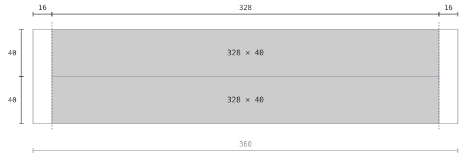
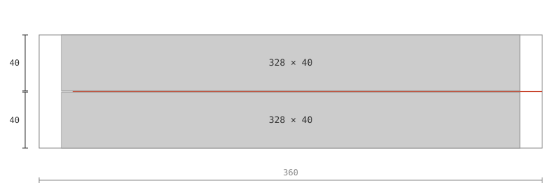
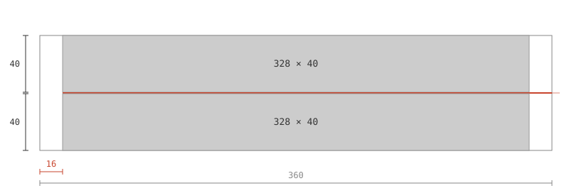
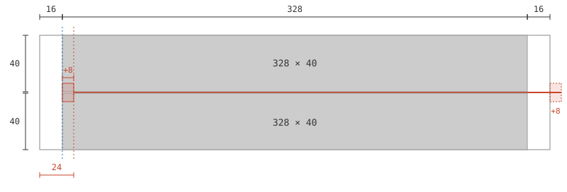
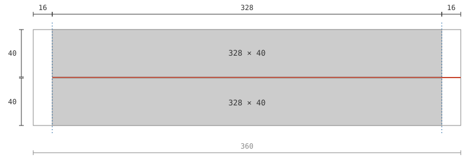

---

categories:

- Android
date: 2026-10-28T05:10:00.000Z
description: 给 LinearLayout 里的分割线加了个 marginStart，左侧的 16dp 却凭空变成了 24dp？
draft: false
slug: linear-layout-divider
tags:
- Android
- UI
title: 一条多出 8dp 的分割线

---

> 没想到 2026 年了还能来一场酣畅淋漓的 Android bug 问题排查

# 一个平平无奇的布局

假设现在有以下 Android 布局：

```xml
<?xml version="1.0" encoding="utf-8"?>
<LinearLayout xmlns:android="http://schemas.android.com/apk/res/android"
    android:layout_width="match_parent"
    android:layout_height="wrap_content"
    android:gravity="center_horizontal"
    android:orientation="vertical">

    <View
        android:layout_width="match_parent"
        android:layout_height="40dp"
        android:layout_marginStart="16dp"
        android:layout_marginEnd="16dp"
        android:background="#CCCCCC" />

    <View
        android:layout_width="match_parent"
        android:layout_height="40dp"
        android:layout_marginStart="16dp"
        android:layout_marginEnd="16dp"
        android:background="#CCCCCC" />

</LinearLayout>
```

其看起来类似这样：



现在需要为两个元素间增加一个分割线，要求左侧留 16dp 空间，右侧不留：

```xml
<?xml version="1.0" encoding="utf-8"?>
<LinearLayout xmlns:android="http://schemas.android.com/apk/res/android"
    android:layout_width="match_parent"
    android:layout_height="wrap_content"
    android:gravity="center_horizontal"
    android:orientation="vertical">

    <View
        android:layout_width="match_parent"
        android:layout_height="40dp"
        android:layout_marginStart="16dp"
        android:layout_marginEnd="16dp"
        android:background="#CCCCCC" />

    <View
        android:layout_width="match_parent"
        android:layout_height="1dp"
        android:layout_marginStart="16dp"
        android:background="#C8452D" />

    <View
        android:layout_width="match_parent"
        android:layout_height="40dp"
        android:layout_marginStart="16dp"
        android:layout_marginEnd="16dp"
        android:background="#CCCCCC" />

</LinearLayout>
```

代码看起来一切正常，但是等等……怎么跟想象中不太一样：



感觉像是尺寸被 x1.5 了，尝试将 16dp / 1.5：



还真是，不过为什么会这样呢？

细心的朋友已经发现了

我们的父布局是 LinearLayout，而其设置了 `android:gravity="center_horizontal"`，因此我们的分割线实际是这样：



翻一翻 LinearLayout 的源码可以发现，竖直方向 LinearLayout 的 layoutVertical() 里，居中分支是：

```java
childLeft = paddingLeft + ((childSpace - childWidth) / 2)
        + lp.leftMargin - lp.rightMargin;
```


说白了，`center_horizontal` **是在「已经扣掉 margin 的宽度」上居中的，居中之后又把** `marginStart` **加回来**，margin 等于被算了两次。

子 View 测得宽度 \( \mathrm{childWidth} = W - \mathrm{margin} \)，居中位移是 \( (W - \mathrm{childWidth}) / 2 = \mathrm{margin}/2 \)，再加上 \( \mathrm{lp.leftMargin} \)，\( \mathrm{childLeft} \) 就成了 \( 1.5 \cdot \mathrm{margin} \)。

这就是「**看起来 1.5 倍**」的来源，而且它**只在子 View 宽度为** `match_parent` **且父容器** `center_horizontal` **时出现**。

# 一般情况

把上面的推导写成一般形式：

$$
\begin{aligned}
  \mathrm{measuredWidth} &= W - \mathrm{marginStart} - \mathrm{marginEnd} \\
  \mathrm{getLeft}() &= \left\lfloor \frac{W - \mathrm{measuredWidth}}{2} \right\rfloor + \mathrm{marginStart} - \mathrm{marginEnd} \\
            &= \frac{\mathrm{marginStart} + \mathrm{marginEnd}}{2} + \mathrm{marginStart} - \mathrm{marginEnd} \\
            &= \frac{3 \cdot \mathrm{marginStart} - \mathrm{marginEnd}}{2}
\end{aligned}
$$

三种 margin 组合分别对应三种结果：


| margin\_start | margin\_end | getLeft() | 结果 |
| ------------- | ----------- | --------- | -------- |
| \(m\)         | \(m\)       | \(m\)     | 对齐，正常    |
| \(m\)         | \(0\)       | \(1.5m\)  | 多出 \(m/2\) |
| \(0\)         | \(m\)       | \(-0.5m\) | 越出左边界    |


偏移量只和左右 margin 的差有关：

$$
\Delta = L - \mathrm{marginStart} = \frac{\mathrm{marginStart} - \mathrm{marginEnd}}{2}
$$

移除后恢复正常

移除 `center_horizontal` 之后，分割线才回到该在的位置：



若父布局里的其它子 View 还要靠 `center_horizontal` 居中，也可以只给分割线 View 设置 `layout_gravity=start`